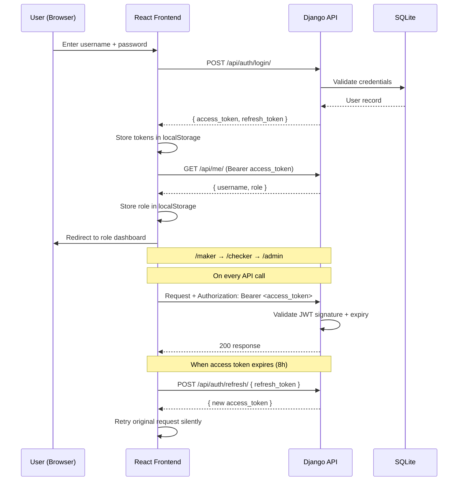
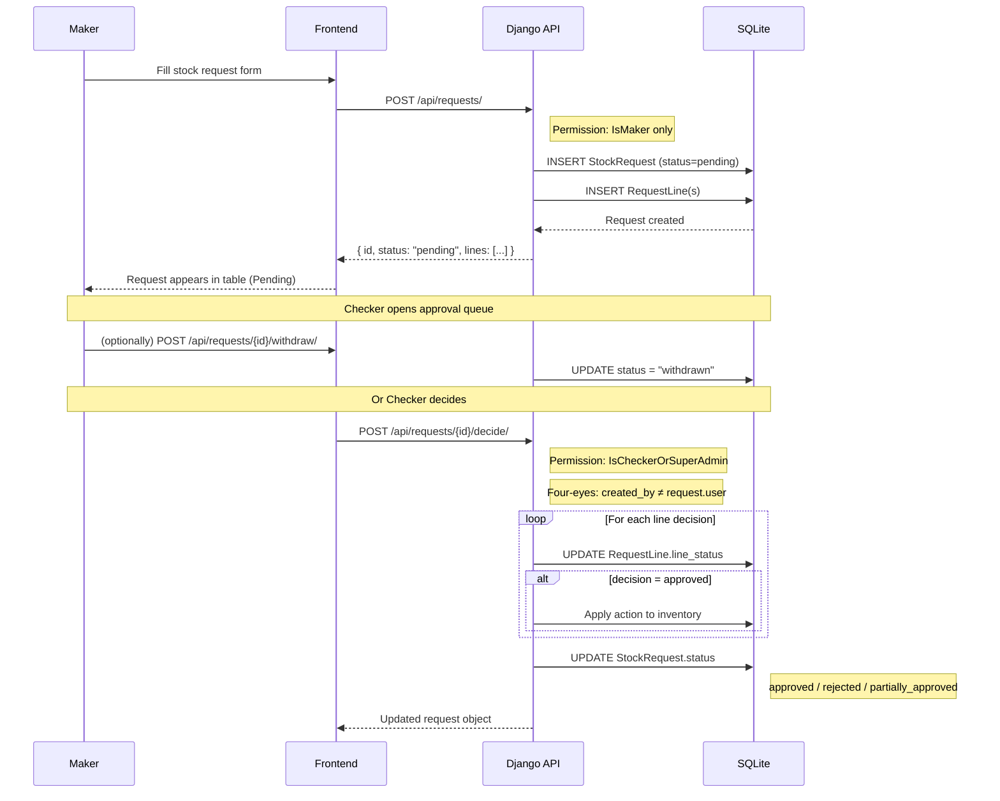

# Data Flow — Inventory Management System

Al Yafour General Contracting · Full-Stack Interview Project

---

## 1. System Overview

```
┌─────────────────────────────────────────────────────────────┐
│                        BROWSER                              │
│  React 19 + TypeScript + TanStack Query + Tailwind CSS     │
│  Hosted: https://inventory-managemnt.onrender.com           │
└─────────────────────┬───────────────────────────────────────┘
                      │  HTTPS  (JWT Bearer token)
                      │  VITE_API_URL = /api
                      ▼
┌─────────────────────────────────────────────────────────────┐
│                     DJANGO API SERVER                       │
│  Django 5.2 + DRF 3.18 + SimpleJWT + Gunicorn              │
│  Hosted: https://alyafour-backend.onrender.com              │
└─────────────────────┬───────────────────────────────────────┘
                      │
                      ▼
┌─────────────────────────────────────────────────────────────┐
│                      DATABASE                               │
│  SQLite  (backend/db.sqlite3)                               │
│  Tables: auth_user · inventory_userprofile                  │
│          inventory_category · inventory_product             │
│          inventory_stockrequest · inventory_requestline     │
└─────────────────────────────────────────────────────────────┘
```

---

## 2. Authentication Flow



---

## 3. Role System

```
┌──────────────────────────────────────────────────────────┐
│                     THREE ROLES                          │
├──────────────────┬───────────────────┬───────────────────┤
│     MAKER        │     CHECKER       │   SUPERADMIN      │
│  (storekeeper)   │    (checker)      │    (admin)        │
├──────────────────┼───────────────────┼───────────────────┤
│ Submit requests  │ Approve / Reject  │ Everything        │
│ Withdraw pending │ View all requests │ Direct CRUD       │
│ View inventory   │ View inventory    │ View all requests │
│ (read-only)      │ (read-only)       │ Approve / Reject  │
└──────────────────┴───────────────────┴───────────────────┘

FOUR-EYES RULE: The person who created a request cannot decide on it.
```

---

## 4. Maker → Checker Approval Workflow



---

## 5. Request Line Actions

Each `RequestLine` has one of three actions. On approval:

```
┌─────────────────────────────────────────────────────────────┐
│  action = "stock_in"                                        │
│  → Product.stock += quantity                                │
│  Fields: product (FK), quantity, unit_cost, supplier,       │
│          uom, warehouse_code, barcode                       │
├─────────────────────────────────────────────────────────────┤
│  action = "new_product"                                     │
│  → Product.objects.create(...)                              │
│  Fields: proposed_name, proposed_sku, proposed_price,       │
│          proposed_stock, proposed_category,                 │
│          proposed_description, proposed_uom,                │
│          proposed_subcategory, proposed_min_stock,          │
│          proposed_reorder_level, warehouse_code, barcode    │
├─────────────────────────────────────────────────────────────┤
│  action = "edit_product"                                    │
│  → Product fields updated in-place                         │
│  Fields: product (FK) + any proposed_* fields to change     │
│          (same proposed_* set as new_product above)         │
└─────────────────────────────────────────────────────────────┘
```

---

## 6. Database Schema

```
auth_user
├── id (PK)
├── username
└── password (hashed)

inventory_userprofile
├── id (PK)
├── user_id (FK → auth_user)
└── role  [maker | checker | superadmin]

inventory_category
├── id (PK)
├── name  (unique)
└── code  (e.g. CEM, STL, AGG)

inventory_product
├── id (PK)
├── name
├── description
├── price  (decimal)
├── stock  (integer ≥ 0)
├── category_id (FK → inventory_category)
├── is_active  (boolean)
├── created_at
└── updated_at

inventory_stockrequest
├── id (PK)
├── created_by_id  (FK → auth_user)
├── decided_by_id  (FK → auth_user, nullable)
├── status  [pending | approved | partially_approved | rejected | withdrawn]
├── document_ref
├── remarks
├── created_at
└── decided_at  (nullable)

inventory_requestline
├── id (PK)
├── request_id  (FK → inventory_stockrequest)
├── action  [stock_in | new_product | edit_product]
├── product_id  (FK → inventory_product, nullable)
├── quantity  (decimal, nullable)
├── unit_cost  (decimal, nullable)
├── supplier
├── uom                          ← unit of measure for stock_in
├── proposed_name
├── proposed_sku                 ← e.g. CEM-0001
├── proposed_price  (decimal, nullable)
├── proposed_stock  (integer, nullable)
├── proposed_category_id  (FK → inventory_category, nullable)
├── proposed_description
├── proposed_uom                 ← unit of measure for new/edit product
├── warehouse_code               ← default: MAIN-WH
├── subcategory
├── proposed_subcategory
├── min_stock  (integer, nullable)
├── proposed_min_stock  (integer, nullable)
├── reorder_level  (integer, nullable)
├── proposed_reorder_level  (integer, nullable)
├── barcode
├── line_status  [pending | approved | rejected]
└── rejection_reason
```

---

## 7. API Endpoints

| Method | Endpoint | Permission | Description |
|--------|----------|------------|-------------|
| POST | `/api/auth/login/` | Public | Obtain JWT tokens |
| POST | `/api/auth/refresh/` | Public | Refresh access token |
| GET | `/api/me/` | Authenticated | Current user + role |
| GET | `/api/categories/` | Authenticated | List all categories |
| GET | `/api/products/` | Authenticated | List products (search, filter, paginate) |
| POST | `/api/products/` | Authenticated | Create product directly |
| PATCH | `/api/products/{id}/` | Authenticated | Update product directly |
| DELETE | `/api/products/{id}/` | Authenticated | Delete product |
| GET | `/api/requests/` | Authenticated | List requests (Maker: own only; Checker/Admin: all) |
| POST | `/api/requests/` | Maker only | Submit new stock request |
| GET | `/api/requests/{id}/` | Authenticated | Get request detail with lines |
| POST | `/api/requests/{id}/withdraw/` | Maker (own) | Withdraw pending request |
| POST | `/api/requests/{id}/decide/` | Checker / SuperAdmin | Approve or reject lines |

---

## 8. Frontend Data Flow (TanStack Query)

```
Component mounts
      │
      ▼
useQuery(['products', filters])
      │
      ├─ cache hit (< 30s stale) ──► render cached data immediately
      │
      └─ cache miss / stale
            │
            ▼
        api.get('/products/', { params })
            │
            ├─ 200 ──► update cache ──► re-render
            │
            └─ 401 ──► interceptor fires
                          │
                          ├─ refresh token exists ──► POST /auth/refresh/
                          │                              │
                          │                         new access token
                          │                              │
                          │                         retry original request
                          │
                          └─ no refresh token ──► localStorage.clear()
                                                  redirect to /login
```
